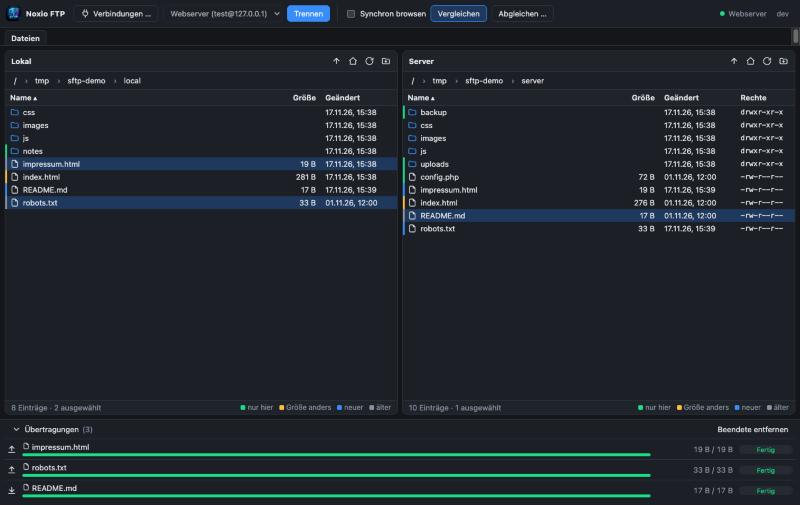
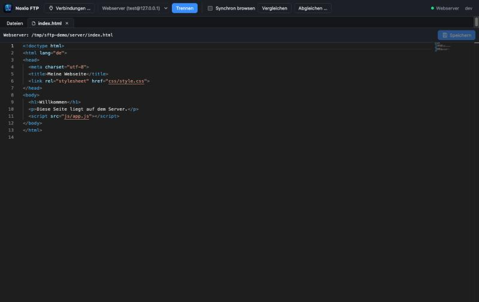
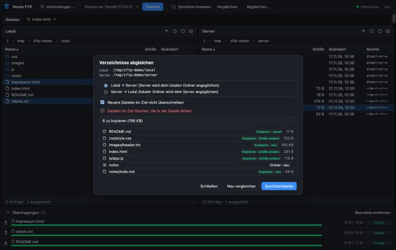
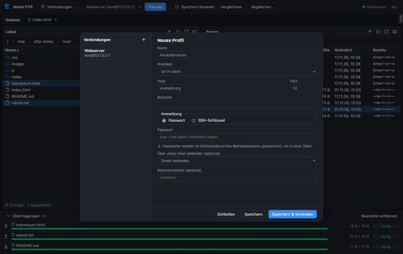

<div align="center">


# Noxio FTP

**Ein schneller Datei-Client für SFTP, FTPS und FTP – mit eingebautem Editor.**
Zwei Fenster, Drag&nbsp;&amp;&nbsp;Drop, Warteschlange und Abgleich, für macOS, Windows und Linux.

[](https://github.com/Lauras-Universe/noxioftp/actions/workflows/build.yml)


[](LICENSE)



</div>

## Inhalt

- [Funktionen](#funktionen)
- [Installation](#installation)
- [Updates](#updates)
- [Sicherheit und Datenschutz](#sicherheit-und-datenschutz)
- [Konfiguration](#konfiguration)
- [Entwickeln](#entwickeln)
- [Release veröffentlichen](#release-veröffentlichen)
- [Projektaufbau](#projektaufbau)
- [Bekannte Grenzen](#bekannte-grenzen)
- [Haftungsausschluss](#haftungsausschluss)
- [Lizenz](#lizenz)

## Funktionen

**Dateien verwalten**
- Zwei Fenster wie bei FileZilla: lokal links, Server rechts. Sortierung, klickbare Pfadleiste, Tastatur (↑ ↓, Enter, F2, F5, Entf, ⌘/Strg + A) und Rechtsklick-Menü
- **Drag & Drop**: zwischen den Fenstern überträgt, innerhalb eines Fensters verschiebt (auf einen Ordner oder ein Pfad-Segment ziehen)
- Neuer Ordner, Umbenennen, Löschen und **Zugriffsrechte ändern** (SFTP, FTP und FTPS)

**Übertragen**
- Warteschlange mit drei parallelen Übertragungen, Fortschritt, Abbrechen und Wiederholen
- Ordner rekursiv, Symlinks werden aufgelöst (Schleifen und defekte Links werden übersprungen und gemeldet)
- Konfliktregel bei vorhandenen Dateien: überschreiben, überspringen oder umbenennen

**Abgleichen**
- **Synchron browsen**: das andere Fenster folgt jeder Navigation
- **Vergleichen**: Unterschiede zwischen beiden Ordnern farbig markiert (nur hier, Größe anders, neuer, älter)
- **Abgleichen**: einseitig angleichen mit Vorschau. Optional überzählige Dateien löschen, neuere Dateien im Ziel schonen

**Bearbeiten**
- Eingebauter Editor ([Monaco](https://microsoft.github.io/monaco-editor/), bekannt aus VS Code): Doppelklick auf eine Server-Datei, <kbd>⌘</kbd>/<kbd>Strg</kbd> + <kbd>S</kbd> speichert direkt zurück
- Tabs, Syntax-Hervorhebung für gängige Sprachen, Suchen und Ersetzen, Code-Faltung, Mehrfach-Cursor
- Warnt, wenn die Datei auf dem Server inzwischen geändert wurde. Lehnt Binär-, Nicht-UTF-8-Dateien und Dateien über 5 MB ab

**Verbinden**
- **SFTP**, **FTPS** (explizit und implizit) und **FTP**
- Anmeldung per Passwort oder SSH-Schlüssel (auch mit Passphrase)
- **Jump-Host** (wie `ProxyJump`), auch verkettet
- Passwörter liegen im Schlüsselbund des Betriebssystems, nie in einer Datei
- Beim Beenden fragt das Programm nach, wenn der Editor ungespeicherte Änderungen hat oder Übertragungen laufen

| Editor | Abgleich |
| :---: | :---: |
|  |  |

| Verbindungsmanager |
| :---: |
|  |

## Installation

Die Programme sind **nicht signiert**: Ein Zertifikat von Apple bzw. Microsoft kostet Geld, und ohne dieses
zeigen macOS und Windows eine Sicherheitswarnung. Sie erscheint nur bei Dateien, die der **Browser** heruntergeladen hat.
Es gibt deshalb zwei Wege:

| | Terminal / PowerShell (empfohlen) | Download im Browser |
| --- | --- | --- |
| Sicherheitswarnung | **keine** | **bei jedem Download**, also bei der Erstinstallation und bei jedem manuellen Update |
| Aufwand | ein Befehl | Datei laden, entpacken, Warnung bestätigen |
| Update | Befehl erneut ausführen | Programm aktualisiert sich selbst, siehe [Updates](#updates) |

### Per Terminal oder PowerShell (empfohlen)

Das Skript lädt das neueste Release direkt von GitHub. Weil der Download nicht über den Browser läuft, setzt das
Betriebssystem keine „aus dem Internet“-Markierung, und das Programm startet ohne Rückfrage.

**macOS und Linux** – installiert `NoxioFTP.app` nach `~/Applications` bzw. `noxioftp` nach `~/.local/bin` (unter Linux mit Eintrag im Anwendungsmenü):

```bash
curl -fsSL https://raw.githubusercontent.com/Lauras-Universe/noxioftp/main/scripts/install.sh | sh
```

**Windows** (PowerShell) – installiert nach `%LOCALAPPDATA%\Programs\NoxioFTP` und legt einen Startmenü-Eintrag an:

```powershell
irm https://raw.githubusercontent.com/Lauras-Universe/noxioftp/main/scripts/install.ps1 | iex
```

> **Update:** Denselben Befehl einfach erneut ausführen. Das Programm weist beim Start darauf hin, sobald eine neue
> Version vorliegt.

### Als Download aus dem Browser

Datei von der [Release-Seite](https://github.com/Lauras-Universe/noxioftp/releases/latest) laden
(`noxioftp-macos.zip`, `noxioftp-windows.zip` oder `noxioftp-linux.tar.gz`), entpacken und starten.
Dann erscheint die Warnung, **jedes Mal wenn die Datei neu aus dem Browser geladen wurde**:

- **macOS:** Beim ersten Start meldet macOS, die App könne nicht geprüft werden. *Systemeinstellungen › Datenschutz & Sicherheit*
  öffnen, nach unten scrollen und bei der App auf **Trotzdem öffnen** klicken, dann bestätigen.
  (Seit macOS 15 genügt Rechtsklick › Öffnen nicht mehr.)
- **Windows:** SmartScreen zeigt „Der Computer wurde durch Windows geschützt“. Auf **Weitere Informationen** klicken,
  dann auf **Trotzdem ausführen**.
- **Linux:** Archiv entpacken, die Datei ausführbar machen (`chmod +x NoxioFTP`) und starten. Voraussetzung sind
  `libgtk-3` und `libwebkit2gtk-4.1`.

Wer den Download im Browser macht, muss die Warnung also bei **jedem Update** erneut bestätigen. Wer per
Terminal bzw. PowerShell installiert oder die eingebaute Update-Funktion nutzt, sieht sie nicht.

## Updates

Beim Start fragt das Programm bei GitHub nach dem neuesten Release. Gibt es eine neuere Version, erscheint ein
Dialog mit den Änderungen. Je nachdem, wie das Programm installiert wurde, passiert Folgendes:

| Installation | Verhalten im Update-Dialog |
| --- | --- |
| **Per Terminal / PowerShell** | Das Programm bittet, den Installationsbefehl **erneut auszuführen**, und zeigt ihn zum Kopieren an |
| **Aus dem Browser geladen** | **Ein Klick auf „Jetzt aktualisieren“**: Das Programm lädt das neue Release von GitHub, prüft die SHA-256-Prüfsumme, ersetzt sich selbst und startet neu. Es entsteht keine neue Sicherheitswarnung |
| Nicht ersetzbar (z. B. schreibgeschützter Ordner) | Das Programm nennt den Grund und zeigt den Installationsbefehl |

Mit „Diese Version überspringen“ wird der Hinweis für genau diese Version nicht mehr angezeigt. Die Versionsnummer
oben rechts im Fenster ist anklickbar und prüft jederzeit manuell.

Die Prüfung ist eine einzige anonyme Anfrage an die öffentliche GitHub-Schnittstelle. Es werden keine Daten über dich oder
deine Verbindungen gesendet. Wer sie nicht möchte, setzt die Umgebungsvariable `NOXIOFTP_NO_UPDATE_CHECK=1`.

## Sicherheit und Datenschutz

- **Host-Schlüssel (SFTP):** Unbekannte Server müssen einmal bestätigt werden (trust on first use). Meldet ein bekannter Server einen anderen Schlüssel, bricht die Verbindung ab. Ein Dialog zeigt den gespeicherten und den neuen Fingerabdruck. Nur eine ausdrückliche Bestätigung ersetzt den Schlüssel, etwa wenn der Server neu aufgesetzt wurde. Der Fingerabdruck sollte dann beim Hoster geprüft werden
- **Zertifikate (FTPS):** Zertifikate öffentlicher Stellen werden normal geprüft. Alle anderen müssen einmal per SHA-256-Fingerabdruck bestätigt werden, jede spätere Änderung bricht die Verbindung ab
- **Unverschlüsseltes FTP** verlangt vor jeder Verbindung eine ausdrückliche Bestätigung
- **Geheimnisse** (Passwörter, Passphrasen) liegen im Schlüsselbund von macOS, Windows bzw. Linux, nicht in den Einstellungsdateien
- **Updates** werden nur von der Release-Seite dieses Repositorys geladen und gegen die mitgelieferte `sha256sums.txt` geprüft. Bei fehlender oder falscher Prüfsumme bricht das Update ab
- Es gibt keine Telemetrie

## Konfiguration

Die Einstellungen (`connections.json`, `known_hosts`, `known_certs`) liegen unter `os.UserConfigDir()/NoxioFTP/`,
also `~/Library/Application Support/NoxioFTP` (macOS), `%AppData%\NoxioFTP` (Windows) und `~/.config/NoxioFTP` (Linux).
Einstellungen aus dem früheren Ordner `sftp-client` (Versionen vor der Namensgebung) werden beim ersten Start übernommen.

| Umgebungsvariable | Wirkung |
| --- | --- |
| `NOXIOFTP_CONFIG_DIR` | anderer Ordner für die Einstellungen (portable Nutzung, Tests) |
| `NOXIOFTP_NO_UPDATE_CHECK` | schaltet die Update-Prüfung beim Start ab |
| `NOXIOFTP_VERSION`, `NOXIOFTP_UPDATE_API` | nur zum Testen des Update-Ablaufs gegen einen lokalen Server |

## Entwickeln

Voraussetzungen: [Go](https://go.dev), [Node.js](https://nodejs.org) und die Wails-CLI
(`go install github.com/wailsapp/wails/v2/cmd/wails@latest`). Unter Linux zusätzlich `libgtk-3-dev` und `libwebkit2gtk-4.1-dev`.

```bash
wails dev            # Live-Entwicklung; im Browser auch unter http://localhost:34115
wails build          # Release-Build für die aktuelle Plattform nach build/bin
go test -race ./...  # Backend-Tests
```

Zum Ausprobieren gibt es zwei lokale Test-Server (nur Loopback, Benutzer `test`, Passwort `test`):

```bash
go run ./tools/testsftpd -root /pfad/zum/testordner   # SFTP auf 127.0.0.1:2222
go run ./tools/testftpd  -root /pfad/zum/testordner   # FTP  auf 127.0.0.1:2121
```

Die Ausgabe von `testsftpd` (`[127.0.0.1]:2222 ssh-ed25519 …`) lässt sich in die `known_hosts`-Datei der App kopieren,
um den Host-Schlüssel-Dialog zu überspringen.

Die CI ([`build.yml`](.github/workflows/build.yml)) führt bei jedem Push die Tests aus und baut das Programm für
macOS (universal), Windows und Linux.

## Release veröffentlichen

Ein Tag der Form `v1.2.3` löst in der CI den Release-Build aus. Die Version wird ins Programm eingebaut,
`sha256sums.txt` erzeugt und alles an ein neues GitHub-Release gehängt:

```bash
git tag v1.2.3 && git push origin v1.2.3
```

Builds ohne Tag tragen die Version `dev` und prüfen nicht auf Updates.

## Projektaufbau

```
app.go, update.go, main.go   Wails-Bindings (alles, was das Frontend aufruft)
internal/appinfo             Name des Programms und Ort der Einstellungen
internal/remote              gemeinsame Schnittstelle für SFTP, FTP und FTPS
internal/sftpclient          SSH/SFTP inkl. Jump-Host
internal/ftpclient           FTP/FTPS mit Verbindungspool
internal/connections         Profile, Schlüsselbund, known_hosts, Zertifikat-Pins
internal/transfer            Warteschlange und Abgleich
internal/update              Update-Prüfung, Download, Prüfsumme, Ersetzen
internal/localfs, fsinfo     lokales Dateisystem und gemeinsame Typen
frontend/src                 Vue-3-App (Pinia, Monaco)
scripts/                     Installationsskripte (install.sh, install.ps1)
tools/                       lokale Test-Server (testsftpd, testftpd)
```

Gebaut mit [Wails](https://wails.io), [Vue](https://vuejs.org), [Monaco Editor](https://microsoft.github.io/monaco-editor/),
[pkg/sftp](https://github.com/pkg/sftp) und [jlaffaye/ftp](https://github.com/jlaffaye/ftp).

## Bekannte Grenzen

- Der Abgleich ist einseitig (Quelle → Ziel), kein Zwei-Wege-Merge
- Zugriffsrechte ändern bei FTP braucht einen Server mit `SITE CHMOD`. Die Rechte-Spalte füllt sich aus der `LIST`-Ausgabe im Unix-Format, Server mit DOS-/IIS-Listings liefern keine Rechte. Dafür wird jedes Verzeichnis bei FTP ein zweites Mal gelistet
- Bei FTP lassen sich Symlink-Schleifen nicht erkennen, die Ordnertiefe ist deshalb auf 64 begrenzt
- Das Passwort bzw. die Passphrase eines Jump-Hosts muss in dessen Profil gespeichert sein
- Die Programme sind nicht signiert, siehe [Installation](#installation)

## Haftungsausschluss

Noxio FTP wird kostenlos und ohne Gewähr bereitgestellt.

- **Keine Garantie auf Weiterentwicklung.** Es gibt keinen Anspruch auf neue Funktionen, Fehlerbehebungen, Support oder Updates.
  Das Projekt kann jederzeit ohne Ankündigung geändert, pausiert oder eingestellt werden.
- **Keine Garantie auf Funktion.** Das Programm ist weder fehlerfrei noch auf jedem System, mit jedem Server oder in jeder
  Situation vollständig funktionsfähig. Eine 100%ige Funktionalität wird nicht zugesichert.
- **Nutzung auf eigene Verantwortung.** Bei Übertragungen, Abgleichen, Löschen, Verschieben und beim Speichern im Editor
  können Daten überschrieben oder gelöscht werden. Wichtige Daten bitte vorher sichern und Abgleiche in der Vorschau prüfen.

Maßgeblich ist der Haftungsausschluss der GPL (Abschnitte 15 und 16 in [LICENSE](LICENSE)). Gesetzlich zwingende Haftung bleibt davon unberührt.

## Lizenz

Noxio FTP ist freie Software unter der **GNU General Public License, Version 3** ([LICENSE](LICENSE)),
mit zusätzlichen Bedingungen zu Name, Logo und Hinweisen ([NOTICE.md](NOTICE.md)).

| Das Programm | Gilt |
| --- | --- |
| Unverändert nutzen, auch gewerblich und in Firmen | frei, ohne Auflagen |
| Quellcode lesen, ändern, weitergeben | erlaubt. **Jede weitergegebene Version, auch geänderte oder Programme, die Teile davon enthalten, muss samt Quellcode unter der GPL-3.0 stehen** |
| Verkaufen oder gegen Entgelt anbieten | von der GPL **nicht verboten**. Wer es tut, muss dem Käufer aber den Quellcode geben, und der darf ihn kostenlos weitergeben |
| Name „Noxio FTP“, Logo und Icon | **nicht lizenziert**: Geänderte Versionen brauchen einen eigenen Namen und eigene Grafiken, müssen als geändert gekennzeichnet sein und die Urheberhinweise (Dialog „Über“) behalten |

Diese Tabelle ist nur eine Zusammenfassung, maßgeblich sind die Lizenztexte. Die eingebundenen Bibliotheken
([Wails](https://wails.io), [Vue](https://vuejs.org), [Monaco](https://microsoft.github.io/monaco-editor/),
[pkg/sftp](https://github.com/pkg/sftp), [jlaffaye/ftp](https://github.com/jlaffaye/ftp) u. a.) behalten ihre eigenen, GPL-kompatiblen Lizenzen.
